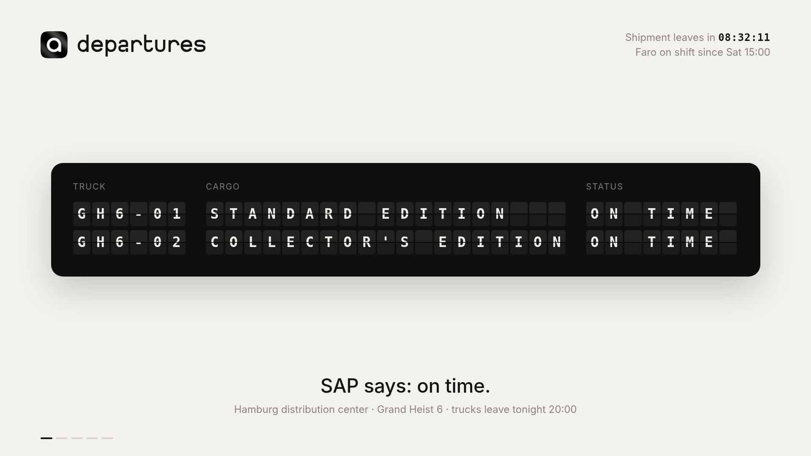
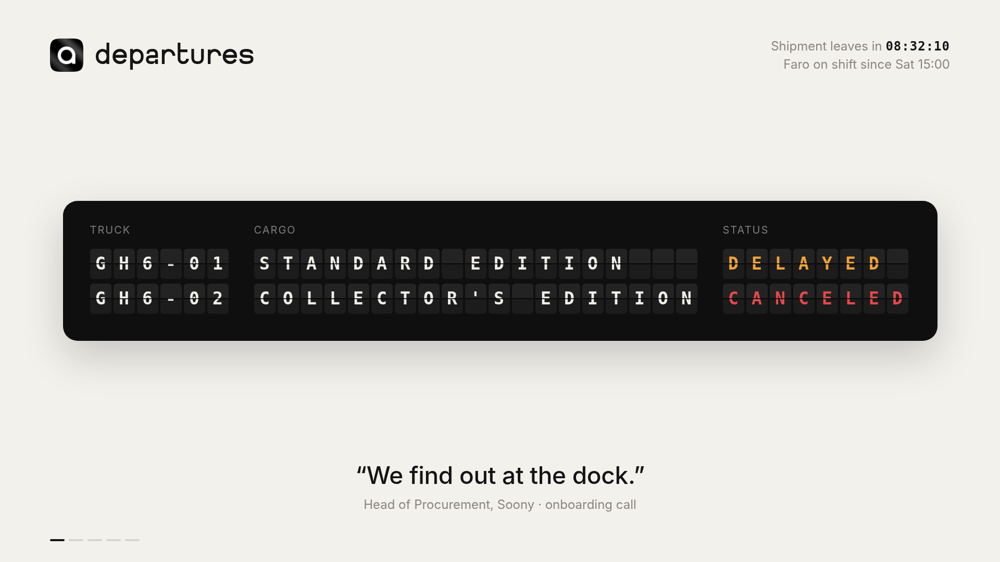
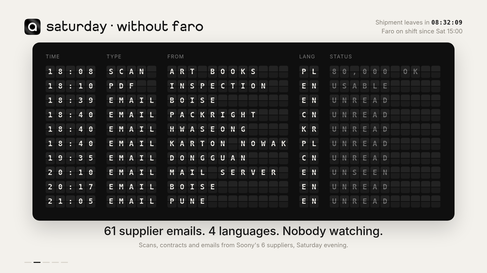
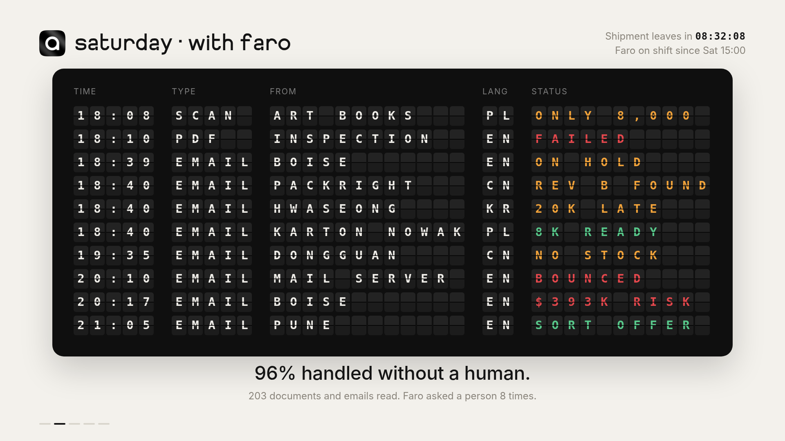
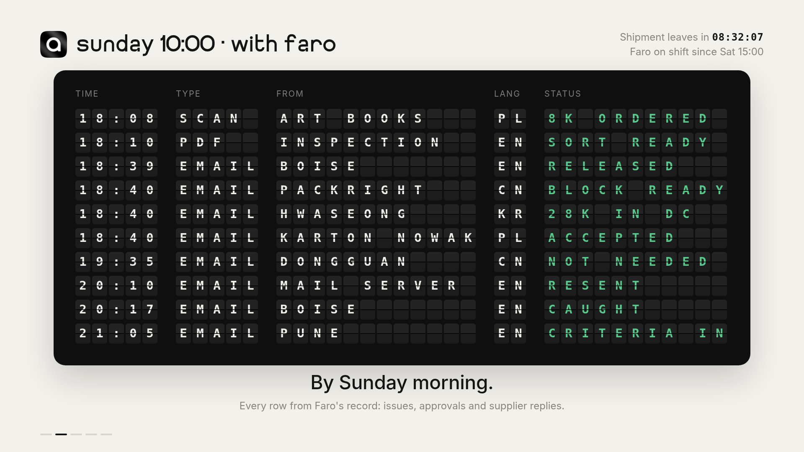
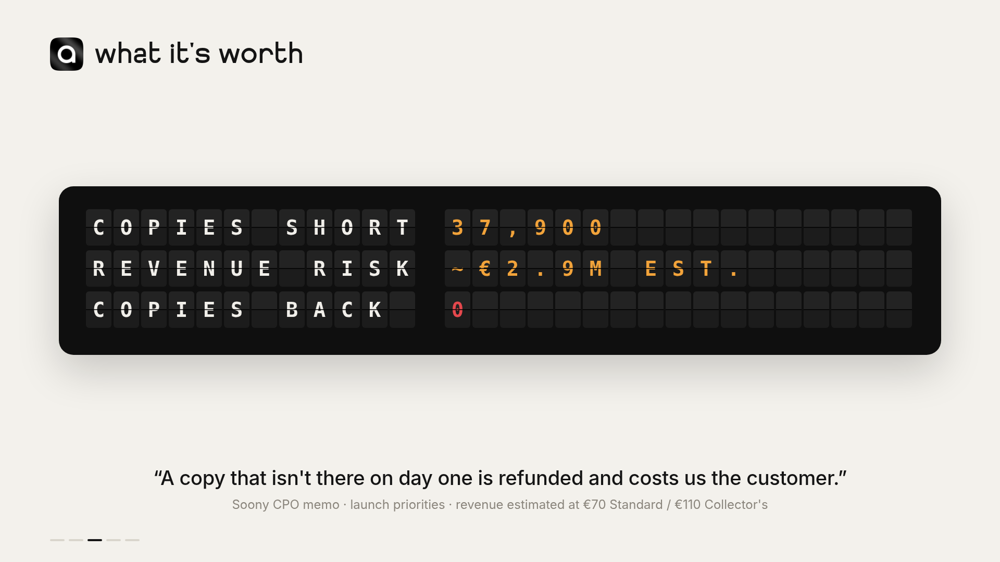
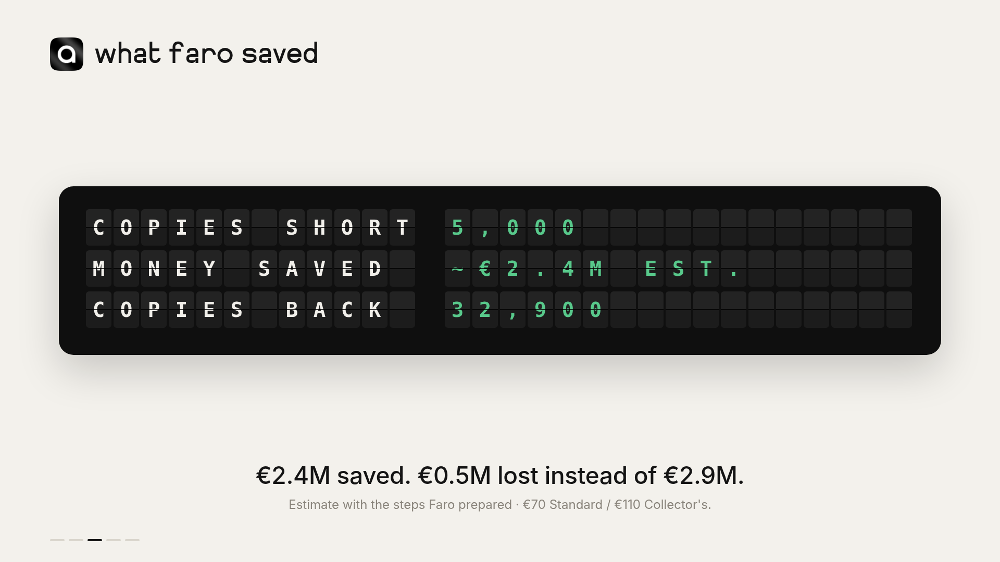
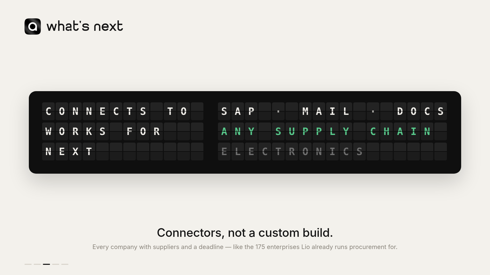
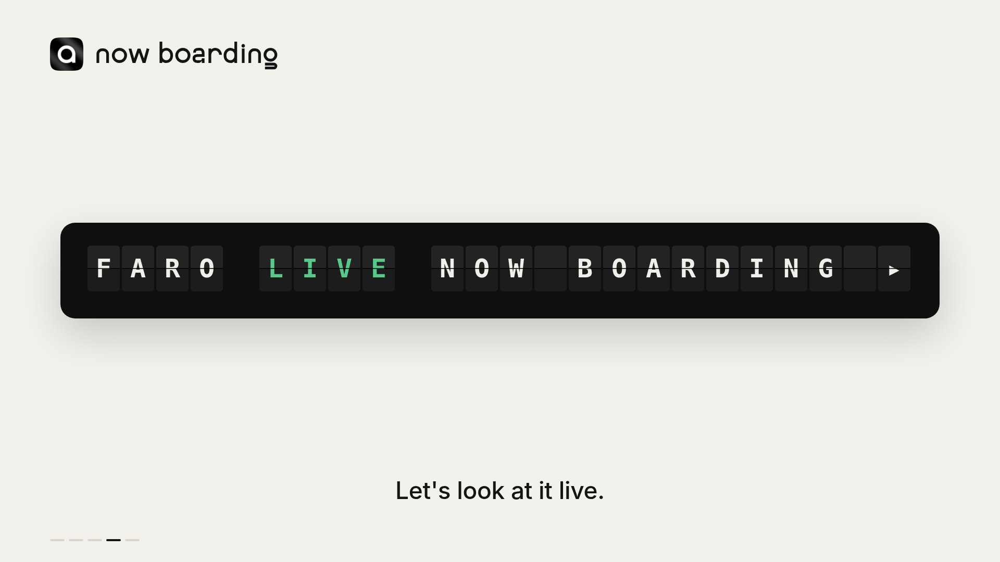
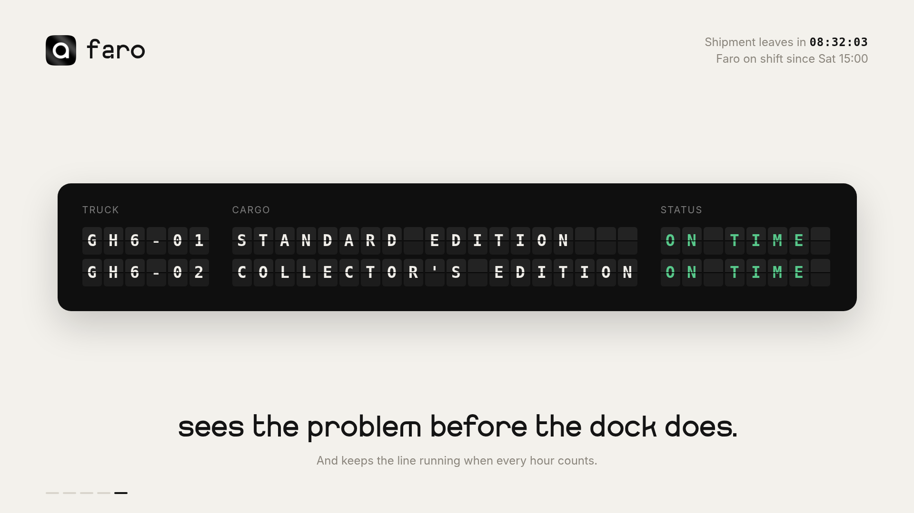

# Pitch deck

Pictures of [`pitch.html`](../pitch.html), one per step, with the speaker notes. GitHub shows the HTML file as source, so this page is the way to read the deck here.

To present it, open <https://kylevon.github.io/StartHack2026/>: arrow keys or click to advance, `F` fullscreen, `N` notes, `S` sound.

This folder is generated. After changing the deck, run `python3 scripts/render_pitch.py`. The countdown in the corner shows the time left when the pictures were taken.

## Slide 1

> <b>0:00–0:25</b> “I'm Alex, and this is Faro. Soony hired us on Friday. Faro started its shift yesterday at 15:00. Tonight at eight, the trucks with Grand Heist 6 leave Hamburg. SAP says everything is on time.” <b>[→ flip]</b> “Reality looks like this. “But Soony's head of procurement told us: we find out at the dock. And Felix said: [Felix's quote, word for word].”

## Slide 2

> <b>0:25–0:50</b> “Saturday evening at Soony. A scan says 80,000 art books. An inspection report says the statues failed. Emails in Polish, Korean and Chinese. The system says everything is fine.” <b>[→ flip]</b> “Faro read all of it. Only 8,000 art books arrived. 20,000 game cards are stuck in Korea. And an email from Soony's own team quietly changed the delivery terms on a 393,000-dollar order. Faro asked a person 8 times in 4 hours. Everything else it handled.” <b>[→ flip]</b> “And by Sunday morning: art books reordered, game cards in Hamburg, the statue sort ready, Boise's terms caught.”

## Slide 3

> <b>worth</b> “Soony's own memo: a copy that isn't there on day one is refunded and costs them the customer. Right now Soony is 37,900 copies short — roughly 2.9 million euros.” <b>[→]</b> “With Faro: 32,900 copies back, only 5,000 short instead of 37,900. Soony loses about half a million instead of 2.9 — with the steps Faro prepared. Faro costs about 30,000 euros per launch.” <b>[→]</b> “And nothing is built for Soony. Faro plugs in through connectors — SAP, mail, documents. Every company with suppliers and a deadline has this Sunday, starting with the 175 companies Lio already runs procurement for.”

## Slide 4

> <b>1:20–1:30</b> “Let's look at it live.” <b>→ switch to Faro.</b> <b>Demo:</b> issue list → I-1: scan vs goods receipt, 80,000 vs 8,000 → A-2 approved → posted to SAP (REC-261121-0001) → I-7: Faro flagged the unapproved EXW switch on a USD 393,000 order → the rule: nothing leaves the building without a human.

## Slide 5

> <b>2:50–3:00 · closing</b> “Faro. It sees the problem before the dock does — and keeps the line running when every hour counts.”
